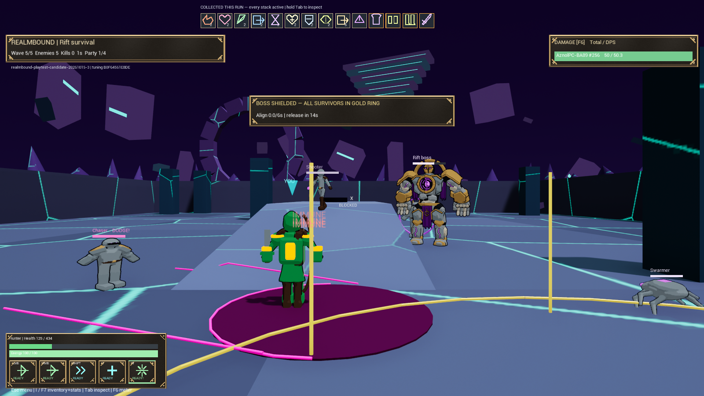

# Realmbound

A third-person fantasy arena roguelite for **1–4 players**. Choose Warrior, Mage or Hunter, collect a build through five scaling waves, then take on the Rift Sentinel.

## Download v0.2.0

**[Get the Windows game](https://github.com/komatosekoala/Realmbound-Downloads/releases/tag/v0.2.0)**

1. Open the release and download **Realmbound-v0.2.0-Win64.zip** under **Assets**.
2. Right-click → **Extract All**. Do not run from inside the ZIP.
3. Open **Windows/Realmbound.exe** and keep every extracted folder beside it.
4. Choose a class, then SOLO or Host.

No Unreal Engine or Blender installation is needed. If Microsoft runtime components are missing, use the included **Windows/Engine/Extras/Redist/en-us/vc_redist.x64.exe**. GitHub's automatic “Source code” downloads are not the playable game.

## Controls

| Input | Action |
| --- | --- |
| Mouse / WASD / Space | Aim / move / jump |
| Left click, hold | Primary |
| Right click | Secondary |
| Shift / 1 / R | Mobility / self-heal / ultimate |
| Mouse wheel | Camera distance |
| Hold Tab | Inspect item and ability icons |
| I or F7 / F6 | Inventory and stats / damage meter |
| Escape / F10 | Menu / settings |

Settings include HUD size, display mode, resolution, sensitivity, invert-Y, volume, frame cap and VSync.

## Classes and loot

- **Warrior:** sword and plate; high health; earns rage from damage.
- **Mage:** staff magic; low health; regenerates mana.
- **Hunter:** bow and mobility; fast-regenerating energy.

All gear copies add to the run—no equip slots. Walk over personal drops. Ordinary kills roll **12% gear** and independently **16% run items**; 15% of gear rolls are Legendary. A bridge pedestal offers a chosen Legendary between waves. Each class has three distinct Legendary mechanics, and stacking items change current stats and abilities. Runs reset; settings persist.

## Play with friends

Everyone needs the **same v0.2.0 ZIP**. The host opens a room; friends use **Join by IP** with the host's reachable IPv4 address, normally **address:7777**. The host starts when the party is connected.

**127.0.0.1/localhost only works on the same PC.** Internet hosting requires reachable **UDP 7777**, suitable routing/firewall setup or an existing virtual LAN. There is no matchmaking, relay, automatic NAT traversal or host migration. Local co-op testing does not guarantee internet reachability.

## Current state

v0.2.0 is an owner-approved playable release of the tested Candidate 3 package, with grey walls and more drops. It is an unsigned early prototype built in **Unreal Win64 Development configuration**, not Shipping or a finished commercial game. Local host development commands remain available; remote cheat requests are rejected.

Fresh builds/package, **86 automation tests** (81 clean, five existing warning groups), navigation on two seeds and host-plus-two-client session/menu/disconnect/quit flow passed.

**Known issue:** an earlier full scripted co-op run stalled at the first boss gold-ring objective at 6600 HP. Whether this is bot pathing or a gameplay defect is unresolved. No new full-run clear, mortal balance trial, WAN guarantee or four-PC performance result is claimed. The screenshot is a staged invulnerable solo fixture.

[Full play guide](HOW_TO_PLAY.md) · [Release notes](RELEASE_NOTES.md)

This repository distributes playable builds and player instructions. The separate source project remains private. Older releases stay available as history; v0.2.0 is the current version.
